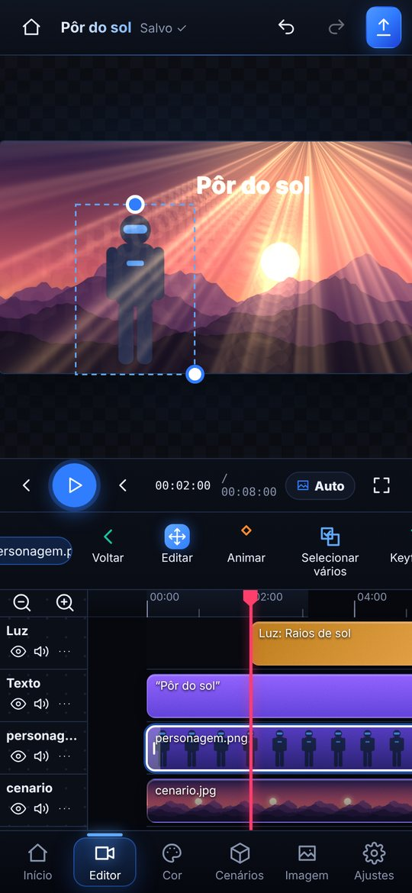
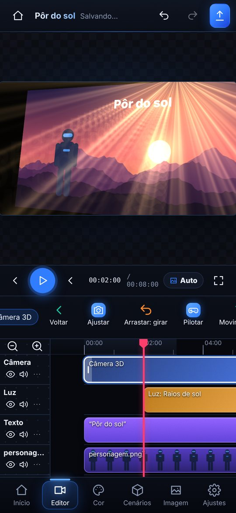
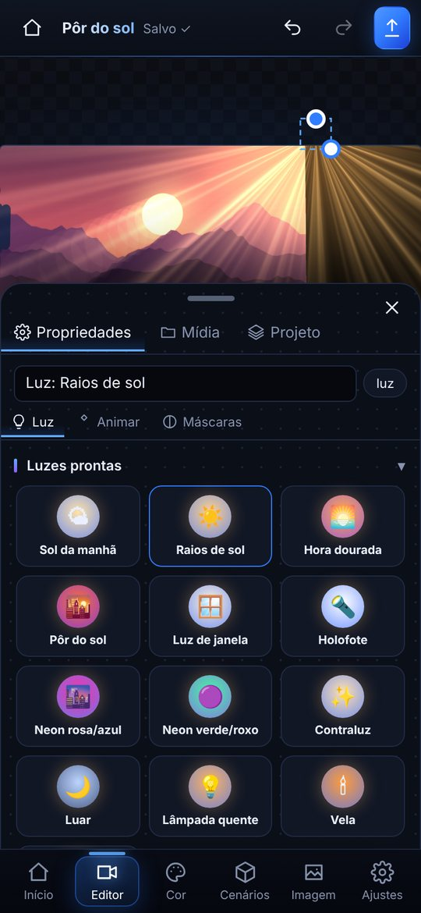
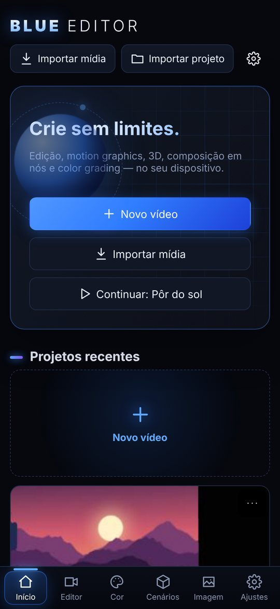
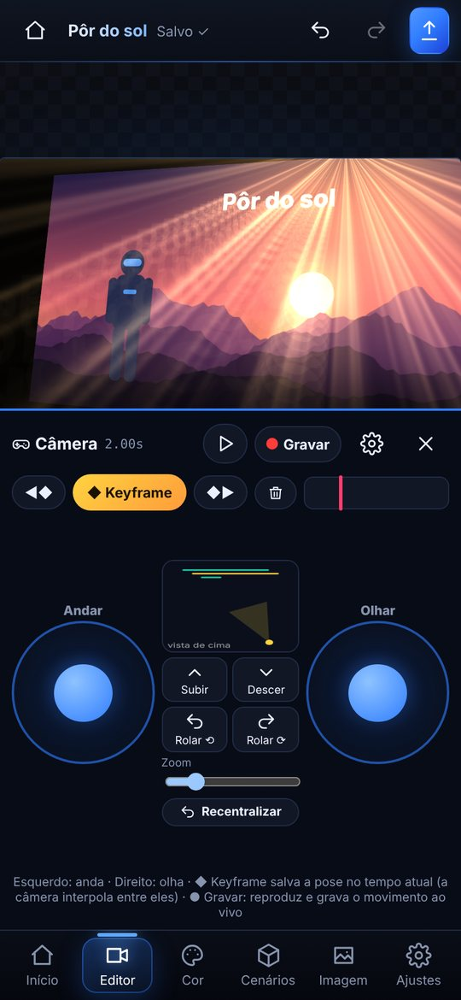
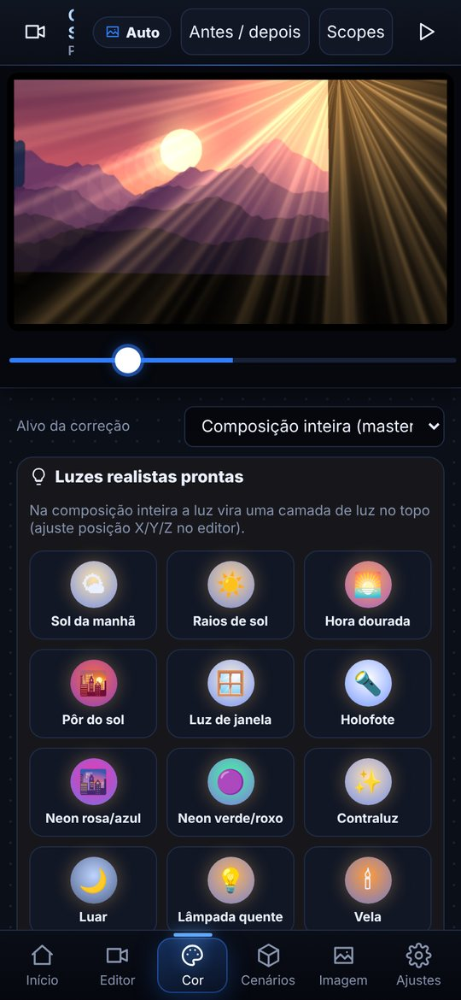
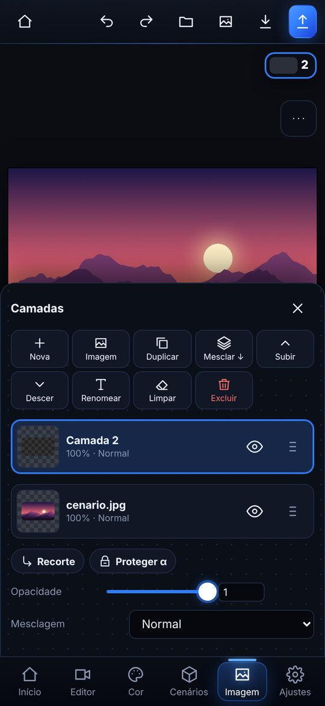
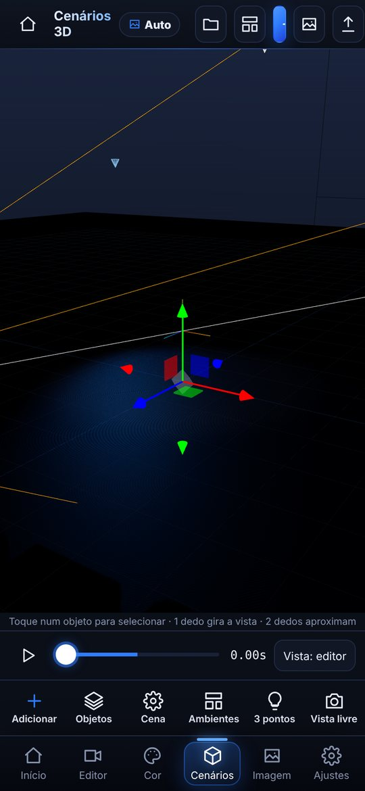
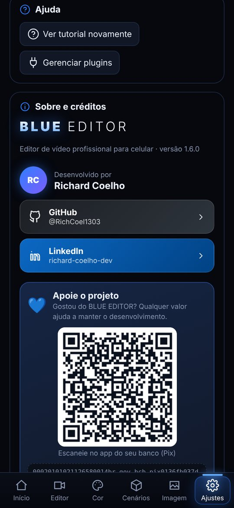

<div align="center">

# 🔵 BLUE EDITOR

**Editor de vídeo profissional feito para o celular.**
Edição, motion graphics, câmera 3D, luzes realistas e color grading, tudo no seu Android, sem conta e sem servidor.


**[⬇️ Baixar o APK (Android)](../../releases/latest)** · **[🌐 Usar no navegador](https://blueeditor.netlify.app)**

  

</div>

---

## ✨ O que ele faz

### 🎬 Edição
- Timeline no estilo Alight Motion: **uma camada por item**, agulha fixa no centro e rolagem com o dedo
- Cortar, dividir, aparar, duplicar, velocidade com **rampas**, reverso, congelar quadro
- **Grupos de camadas** e seleção múltipla com edição em lote
- **Keyframes em tudo**, com editor de curvas, animações prontas e expressões
- Gestos no preview: **pinça para escalar, girar com dois dedos**
- Máscaras (retângulo, elipse, caminho livre) para edição e para correção de cor
- Importação de **PSD com camadas separadas**, fontes em lote (inclusive .zip/.rar)

### 🎥 3D dentro do editor
- **Câmera 3D** de verdade: perspectiva real, órbita, inclinação e **rotação no eixo Z**
- Profundidade Z e rotação X/Y/Z em qualquer camada, profundidade de campo
- **Pilotar a câmera com 2 joysticks**, como num jogo, gravando o movimento em keyframes
- Movimentos prontos: órbita 360°, dolly, travelling, grua, vertigo, câmera na mão
- Área separada de **Cenários 3D** (three.js) com sombras de personagens em PNG e luzes

### 💡 Luzes e cor
- **Camadas de luz** posicionáveis em X/Y/Z: sol com raios volumétricos, hora dourada, janela, holofote, neon, luar, vela e **chamas**
- **Color Studio**: correções em série, curvas, LUTs 3D, scopes e luzes realistas prontas
- Iluminação emitida por objetos (ex.: um GIF de fogo iluminando a cena), com textura e exclusão de camadas

### 🖌️ Image Studio
- **Borracha mágica** no estilo balde do Ibis Paint: toque no fundo e ele some
- Laço, pincel, balde, camadas com recorte (clipping) e proteção de transparência
- Remoção de fundo automática

### ⚡ Desempenho
- Exportação **quadro a quadro** (WebCodecs): o vídeo sai liso mesmo em celular lento
- **MP4 H.264, H.265/HEVC** e WebM VP9, exportação de trecho específico
- Qualidade do preview ajustável: **Auto, Full, 1/2, 1/3, 1/4, 1/8**

### 🧩 Mais
- Formas vetoriais com *trim path*, parentesco entre camadas, eco/rastro de movimento
- Partículas (neve, chuva, brasas), glitch, retrô, desenho animado e mais de 40 efeitos na GPU
- Reator de áudio: batidas automáticas, **cortar no ritmo** e parâmetros que reagem à música
- Marionete com **ossos**: criação por toques, zoom, IK/FK e keyframes
- Sistema de plugins e templates

---

## 📱 Telas

| Início | Editor | Câmera 3D |
|:---:|:---:|:---:|
|  |  |  |
| **Pilotar câmera** | **Luzes** | **Color Studio** |
|  |  |  |
| **Image Studio** | **Cenários 3D** | **Ajustes** |
|  |  |  |

---

## ⬇️ Instalação (Android)

1. Abra a página de **[Releases](../../releases/latest)** e baixe o arquivo `BlueEditor-x.y.z.apk`.
2. Toque no arquivo baixado. Se o Android pedir, permita **"Instalar apps de fontes desconhecidas"** para o seu navegador ou gerenciador de arquivos.
3. Abra o **BLUE EDITOR**. Atualizações instalam por cima, sem perder seus projetos.

> Requer Android 6.0 ou superior. Recomendado: Android 10+ com o WebView do sistema atualizado.

**No navegador:** acesse o [link do app](https://blueeditor.netlify.app). No celular, use "Adicionar à tela inicial" para instalar como app.

---

## 🔒 Privacidade

Seus projetos e mídias **ficam só no seu aparelho**. Não há conta, login, anúncios nem envio de arquivos para servidores.

---

## 🛠️ Tecnologias

TypeScript · WebGL2 / GLSL (efeitos e projeção 3D na GPU) · three.js · WebCodecs (H.264 / H.265 / VP9) · Web Audio · IndexedDB · Capacitor (Android) · MediaPipe

---

## 👤 Autor

Desenvolvido por **Richard Coelho**
[GitHub](https://github.com/RichCoel1303) · [LinkedIn](https://www.linkedin.com/in/richard-coelho-dev)

### 💙 Apoie o projeto
Gostou? Qualquer valor ajuda a manter o desenvolvimento. Pix (copia e cola), também disponível no app em **Ajustes → Apoie o projeto**:

```
00020101021126580014br.gov.bcb.pix0136fb037db5-c880-46c1-b9d0-ad5d4b7256cd5204000053039865802BR5918RICHARD C DA SILVA6013ITAQUAQUECETU62070503***6304C053
```

---

## 📄 Licença

O BLUE EDITOR é **gratuito para usar**, mas o código-fonte **não é aberto**.
Copiar, modificar, redistribuir ou fazer engenharia reversa do aplicativo não é permitido. Veja o arquivo [LICENSE](LICENSE).
